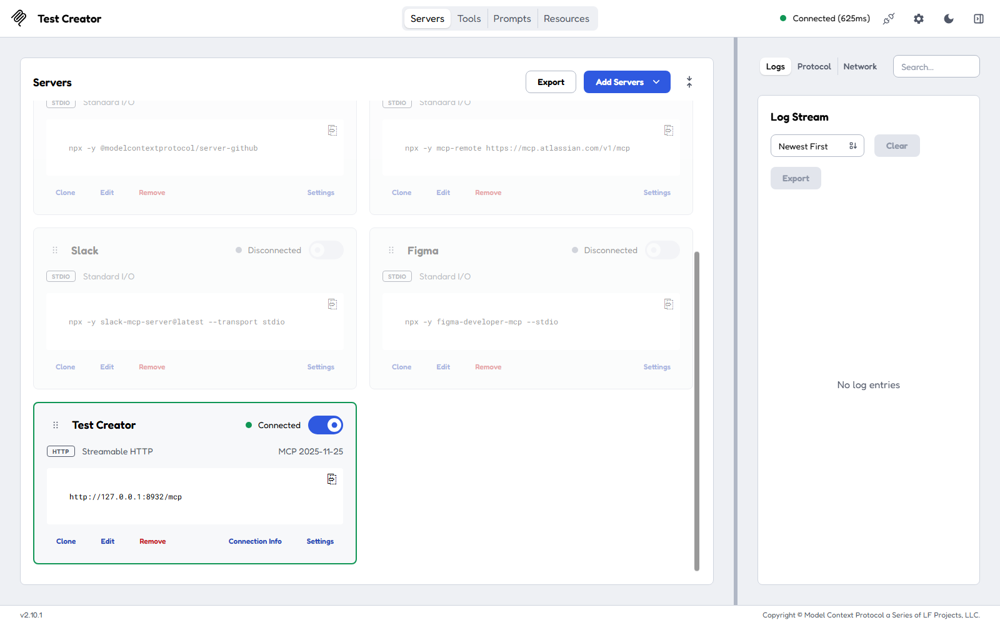
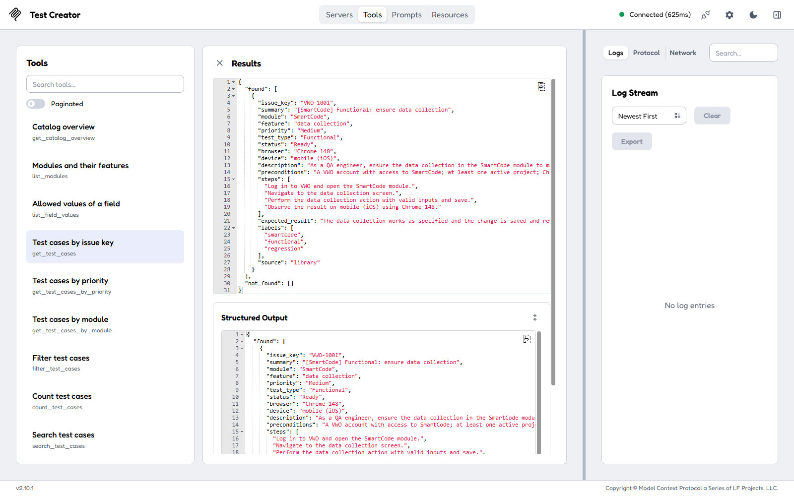
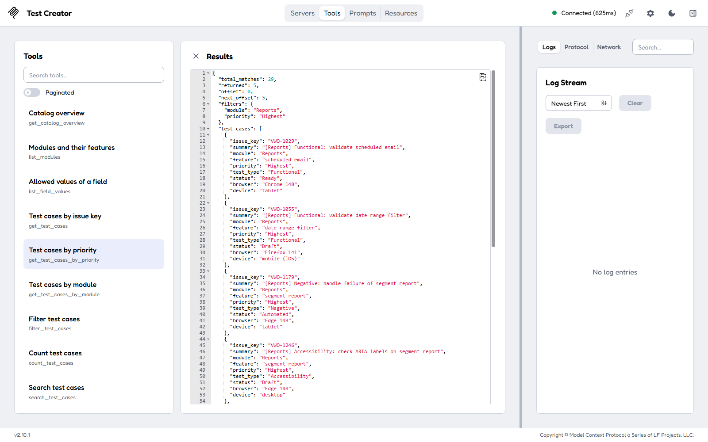
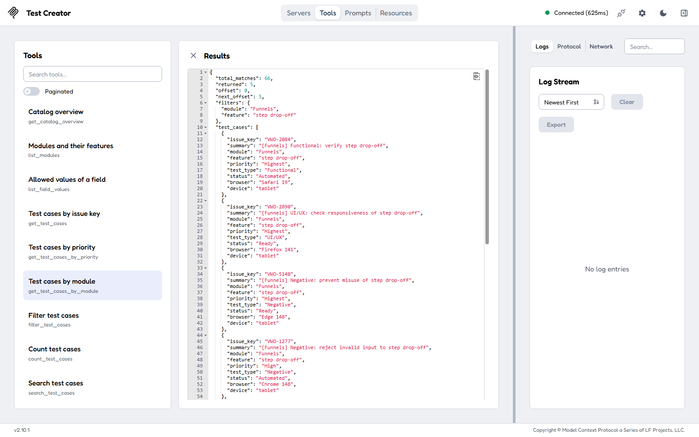
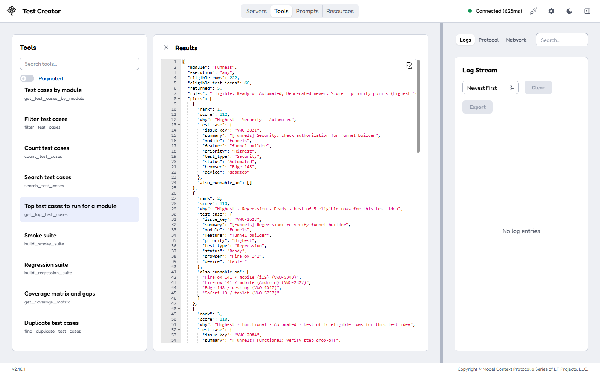
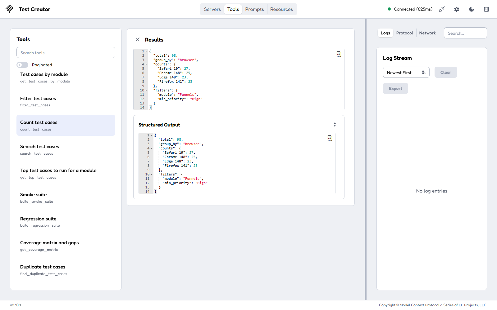
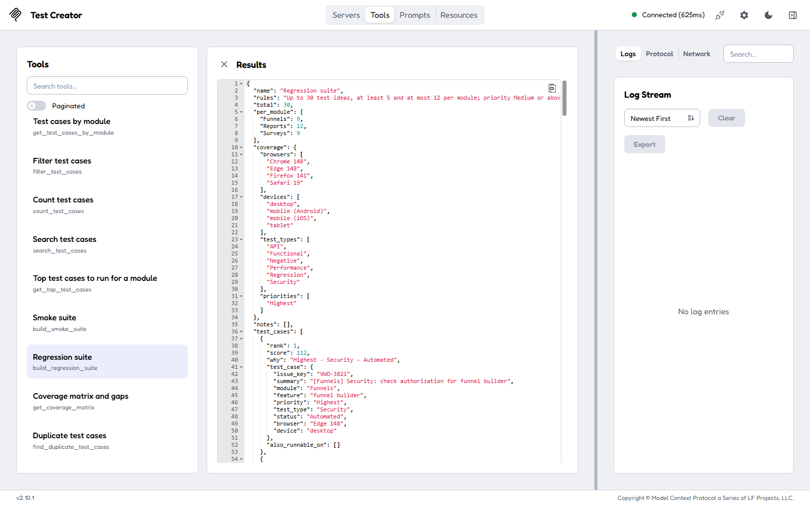

# Test Creator MCP

An MCP server for the VWO test case library ([data/vwo_5000_test_cases.csv](data/vwo_5000_test_cases.csv),
5,000 cases). It finds test cases by priority, module and other fields, ranks the top tests to run for a module,
builds smoke and regression suites, shows coverage gaps and duplicates, and adds new test cases in the house
format. It is built with [FastMCP](https://gofastmcp.com) 4.1. The design is in
[TestCreatorMCP.plan.md](TestCreatorMCP.plan.md), and the original goal in [objective.md](objective.md).

## What it is, in one minute

The library is one big CSV: 5,000 test cases (keys `VWO-1001` to `VWO-6000`) across 17 VWO modules such as
Funnels, Reports and A/B Testing. Each case has a priority (Highest, High, Medium, Low), a test type (Functional,
Security, UI/UX, ...), a status (Ready, Automated, Draft, Deprecated), one browser and one device, 4 steps and an
expected result.

Nobody wants to scroll 5,000 rows. This server puts **tools** in front of the CSV. A tool is a question with
inputs: "give me the Highest-priority Reports tests", "what should we run first for Funnels?". Any MCP client can
call the tools: Claude Code or Claude Desktop (you ask in plain English and Claude calls them), or MCP Inspector
(you fill in the inputs yourself, as in the examples below). The CSV is only read; new test cases go to a
separate file.

## Try it in MCP Inspector

Once the server runs (see [Run and connect](#run-and-connect)), MCP Inspector shows it as a **Test Creator** card.
Switch the card on; it turns green and shows the connection string `http://127.0.0.1:8932/mcp`.



To run a tool: click **Tools** at the top, pick a tool on the left, turn on **Edit as JSON**, paste the input
and press **Execute Tool**. The result replaces the form. Each tool's description also ends with an example input
you can copy.

![get_test_cases selected, Edit as JSON switched on, the input {"issue_keys": ["VWO-1001"]} pasted, and the Execute Tool button](screenshots/02-enter-input-edit-as-json.png)

The six runs below were made exactly this way. Every input can be pasted as it is.

### 1. Look up a test case by its key: `get_test_cases`

Use it when you have a key, for example from a Jira ticket or a bug report, and want the whole test case.

```json
{"issue_keys": ["VWO-1001"]}
```

**Result:** VWO-1001, "[SmartCode] Functional: ensure data collection". It is Medium priority, Ready, and runs on
Chrome 148 on mobile (iOS) for the *data collection* feature. The reply holds its preconditions, the 4 steps, the
expected result and the labels. `not_found` is empty; a key that does not exist would be listed there.
Up to 50 keys fit in one call.



### 2. All test cases of one priority: `get_test_cases_by_priority`

Use it to answer "which Highest-priority tests does a module have?".

```json
{"priority": "Highest", "module": "Reports", "limit": 5}
```

**Result:** `total_matches: 29`, so Reports has 29 Highest-priority cases. Deprecated cases are left out unless
you add `"include_deprecated": true`. The reply returns the first 5 (`"limit": 5`): VWO-1029 (validate scheduled
email), VWO-1055, VWO-1179, VWO-1246 and VWO-1289. `next_offset: 5` means there are more: run it again with
`"offset": 5` to get the next 5. For a range instead of one priority, use `"min_priority": "High"` (High and
Highest) or `"max_priority": "Medium"` (Medium and Low).



### 3. One module, narrowed to one feature: `get_test_cases_by_module`

Use it to see everything that tests one area, most important first.

```json
{"module": "Funnels", "feature": "step drop-off", "limit": 5}
```

**Result:** the step drop-off feature of Funnels has 66 test cases, sorted highest priority first. The first are
VWO-2084 (Functional: verify step drop-off, Highest, Automated), VWO-2890 (UI/UX: responsiveness, Highest) and
VWO-5140 (Negative: prevent misuse, Highest), then two High cases. `list_modules` shows every module's features.
Typing is forgiving: `"funnel"` or `"drop-off"` would have worked too.



### 4. What to run first: `get_top_test_cases`

This is the tool for "we have little time, which Funnels tests matter most?".

```json
{"module": "Funnels", "limit": 5}
```

**Result:** Funnels has 222 runnable rows (Ready or Automated), but only 66 different test ideas, because the same
test repeats for other browsers and devices. The tool keeps the best row of each idea and ranks them:

| Rank | Key | Score | Why |
|---|---|---|---|
| 1 | VWO-3821 | 112 | Highest · Security · Automated |
| 2 | VWO-1628 | 110 | Highest · Regression · Ready · best of 5 eligible rows for this test idea |
| 3 | VWO-2084 | 110 | Highest · Functional · Automated · best of 16 eligible rows for this test idea |
| 4 | VWO-2453 | 110 | Highest · Functional · Ready · best of 19 eligible rows for this test idea |
| 5 | VWO-5007 | 110 | Highest · Regression · Automated · best of 6 eligible rows for this test idea |

Score = priority points + test type points, from [ranking.yaml](src/test_creator_mcp/ranking.yaml). Under
`also_runnable_on` each pick lists the same test on other browsers and devices: VWO-1628 also exists for Firefox
141 / mobile (iOS) as VWO-5343, among others. Deprecated cases are never picked; `"execution": "manual"` keeps
only Ready cases and `"execution": "automated"` only Automated ones.



### 5. Just the numbers: `count_test_cases`

Use it to size a test run before pulling the cases themselves. It is fast and the reply is short.

```json
{"module": "Funnels", "min_priority": "High", "group_by": "browser"}
```

**Result:** 98 Funnels cases are High or Highest priority: Safari 19 has 27, Chrome 148 25, Edge 148 23 and
Firefox 141 23. `group_by` also takes `priority`, `test_type`, `status`, `device` or `feature`.



### 6. A regression suite within limits: `build_regression_suite`

This covers the "maximum and minimum" limits from [objective.md](objective.md): at least and at most so many
tests per module, and a total budget.

```json
{"modules": ["Funnels", "Reports", "Surveys"], "max_total": 30, "min_per_module": 5, "max_per_module": 12, "min_priority": "Medium"}
```

**Result:** a suite of 30 tests: Funnels 9, Reports 12 and Surveys 9, so every module is between 5 and 12 and the
total is 30. It covers all 4 browsers and all 4 devices, and 6 test types. All 30 picks are Highest priority,
because those score best. `notes` is empty, which means everything fit. When the limits cannot all be met, the
notes say what was left out or swapped.



The other 14 tools work the same way; the [Tools](#tools) table lists each with an example input.

## Install

Needs Python 3.10 or later.

```powershell
cd TestCase_Creator_MCP
py -3.11 -m venv .venv
.venv\Scripts\python -m pip install -e ".[dev]"
```

## Run and connect

**Shared over HTTP** (MCP Inspector, n8n, Langflow or any client that takes a URL):

```powershell
.venv\Scripts\tc-mcp --transport http --port 8932
```

Connection string: **`http://127.0.0.1:8932/mcp`** (Streamable HTTP). Use `--host 0.0.0.0` to accept other machines
on your network.

**MCP Inspector:** add a server named "Test Creator" with type Streamable HTTP and the URL above (or put it in
`%USERPROFILE%\.mcp-inspector\mcp.json`). Switch the card on, open **Tools**, and click a tool: every description
ends with an **Example input**. Copy it, turn on **Edit as JSON**, paste, and press **Execute Tool**.
`.venv\Scripts\fastmcp dev inspector server.py` also opens the server in a fresh Inspector.

**Claude Code** (the client starts the server itself, over stdio):

```powershell
claude mcp add test-creator -- "E:\Visual Studio Code\AiTester\11_MCP\MCP_Creation_Vibe_Coding\TestCase_Creator_MCP\.venv\Scripts\tc-mcp.exe"
```

**Claude Desktop, Cursor, VS Code:** an `mcpServers` entry with the same command, or the URL:

```json
{
  "mcpServers": {
    "test-creator": { "command": "<path to>\\TestCase_Creator_MCP\\.venv\\Scripts\\tc-mcp.exe" }
  }
}
```

## Tools

Every tool's description in an MCP client shows a working example input.

| Tool | What it does | Example input |
|---|---|---|
| `get_catalog_overview` | Totals, the next free key, counts by every field | `{}` |
| `list_modules` | The 17 modules with features, counts and automated share | `{}` |
| `list_field_values` | Allowed values of a field, with counts and shortcuts | `{"field": "test_type"}` |
| `get_test_cases` | Full test cases by key | `{"issue_keys": ["VWO-1001", "VWO-2453"]}` |
| `get_test_cases_by_priority` | One priority or a range (`min_priority`, `max_priority`) | `{"min_priority": "High", "module": "Reports", "limit": 10}` |
| `get_test_cases_by_module` | One module, highest priority first | `{"module": "Funnels", "feature": "step drop-off", "limit": 10}` |
| `filter_test_cases` | Any combination of filters | `{"module": "Funnels", "test_type": "Security", "browser": "Safari 19"}` |
| `count_test_cases` | Counts only, optionally grouped | `{"module": "Funnels", "group_by": "browser"}` |
| `search_test_cases` | Keyword search, best match first | `{"query": "keyboard access scheduled email"}` |
| `get_top_test_cases` | The top N to run for a module, ranked, with reasons | `{"module": "Funnels", "limit": 5, "execution": "manual"}` |
| `build_smoke_suite` | Top test ideas of every module | `{"per_module": 2, "max_total": 30}` |
| `build_regression_suite` | A suite within min/max per module and a total, covering every browser and device | `{"modules": ["Funnels", "Reports"], "max_total": 30, "min_per_module": 5}` |
| `get_coverage_matrix` | Counts for two fields, with the empty cells (gaps) | `{"rows": "feature", "columns": "test_type", "module": "Funnels"}` |
| `find_duplicate_test_cases` | Exact copies, or one check repeated across environments | `{"mode": "exact"}` |
| `get_automation_candidates` | Ready cases worth automating next | `{"module": "Funnels", "min_priority": "High"}` |
| `get_test_case_template` | The house format, rules and similar examples | `{"module": "Funnels", "test_type": "Functional"}` |
| `validate_test_case` | Checks a draft: values, 4 steps, summary pattern, duplicates | see the tool's description |
| `create_test_case` | Saves a valid draft with the next key to `new_test_cases.csv` | see the tool's description |
| `create_environment_variants` | Copies a case to other browsers and devices | `{"issue_key": "VWO-3821", "browsers": ["Safari 19"]}` |
| `export_test_cases` | Jira/Xray CSV, Markdown or Gherkin | `{"format": "gherkin", "module": "Funnels", "limit": 3}` |

Limits: lists return 20 by default and at most 100 per call (`limit`, then `offset`/`next_offset` for the next page).
Values match regardless of case, and shortcuts work: `ab` → A/B Testing, `P1` → Highest, `ios` → mobile (iOS).

**How the top tests are ranked:** only Ready and Automated cases (Draft on request, Deprecated never); score =
priority points + test type points, from [ranking.yaml](src/test_creator_mcp/ranking.yaml); the same check on other
browsers and devices collapses into its best row. Edit the weights there, or point `TC_MCP_RANKING` at your own copy.

**Resources:** `tc://schema`, `tc://modules`, `tc://test-cases/{issue_key}`.
**Prompts:** `release_run_plan`, `coverage_review`, `write_test_cases`.

## Settings

| Variable | Default | |
|---|---|---|
| `TC_MCP_CSV` | `data/vwo_5000_test_cases.csv` | The test case library (read only) |
| `TC_MCP_NEW_CASES` | `new_test_cases.csv` next to the library | Where `create_test_case` writes. The library file is never edited |
| `TC_MCP_PROFILE` | `full` | `readonly` hides the two tools that write |
| `TC_MCP_MAX_LIMIT` | `100` | The most test cases one call returns |
| `TC_MCP_RANKING` | the bundled `ranking.yaml` | Scoring weights |

The CSV is re-read when it changes, so updating it needs no restart.

## Tests

```powershell
.venv\Scripts\python -m pytest
```

64 tests check the counts against the raw CSV, every filter and limit, the ranking and suites, authoring (in a
temporary file), and every tool through MCP, including the example input of each tool.

## Troubleshooting

| Symptom | Fix |
|---|---|
| `tc-mcp: Test case file not found` | Set `TC_MCP_CSV` to the CSV's full path |
| Inspector card does not connect | Start the server: `.venv\Scripts\tc-mcp --transport http --port 8932`. Logs: `logs\` when started detached |
| "Unknown module ... Did you mean" | Use the suggested value, or `list_modules` for the exact names |
| In Inspector, which box does the example go in? | The whole example goes in **Edit as JSON**. A field's own box takes only its value, e.g. `["VWO-1001"]` for `issue_keys`. Pasting the whole example into a list field also works, as long as it holds only that field |
| Port 8932 in use | Pick another port with `--port` and update the connection string |
