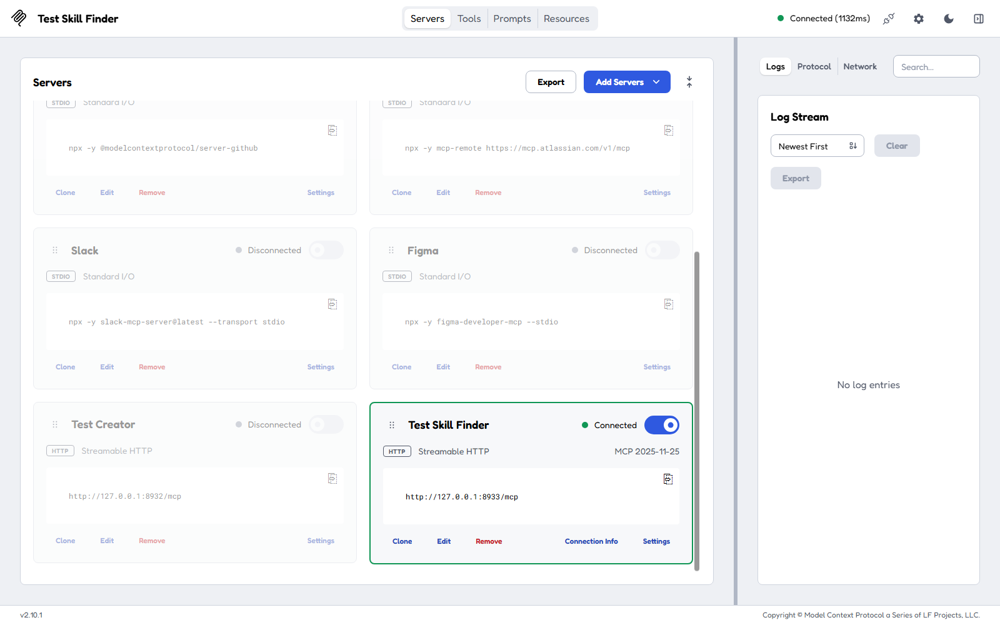
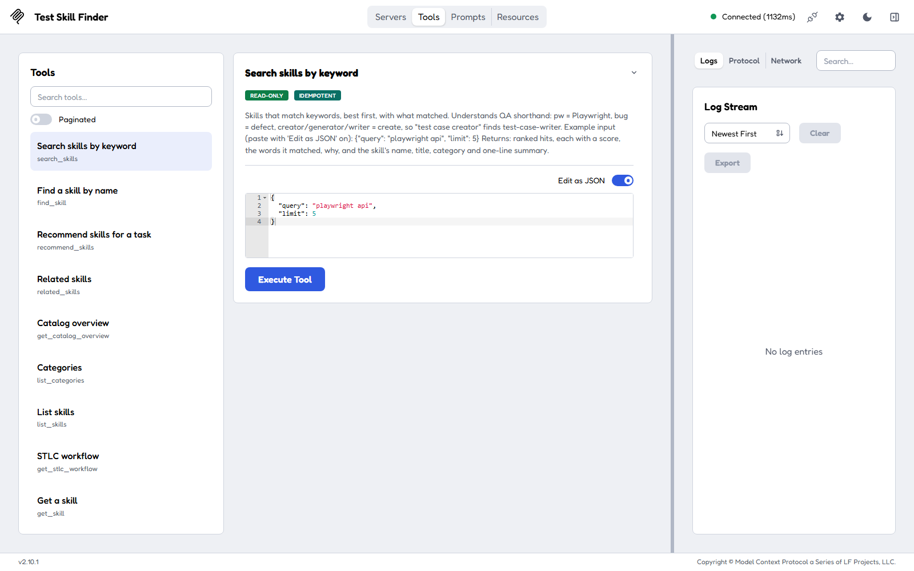
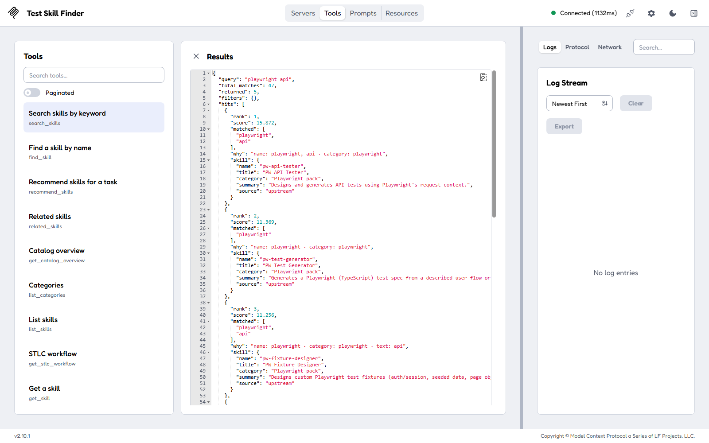
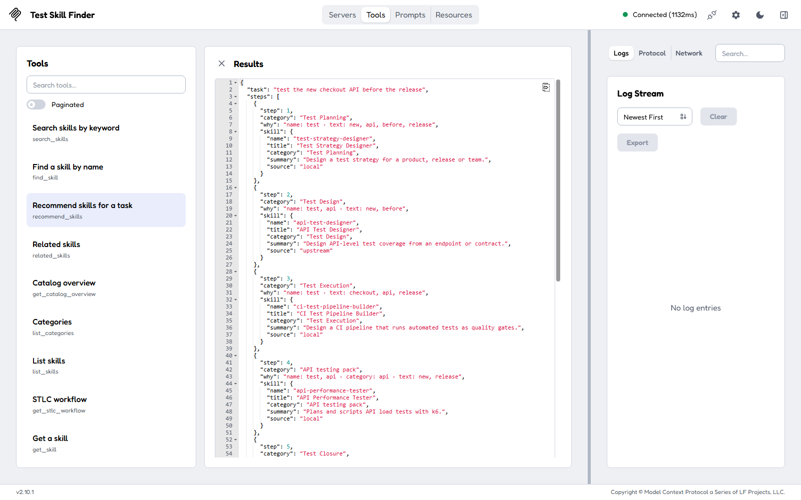
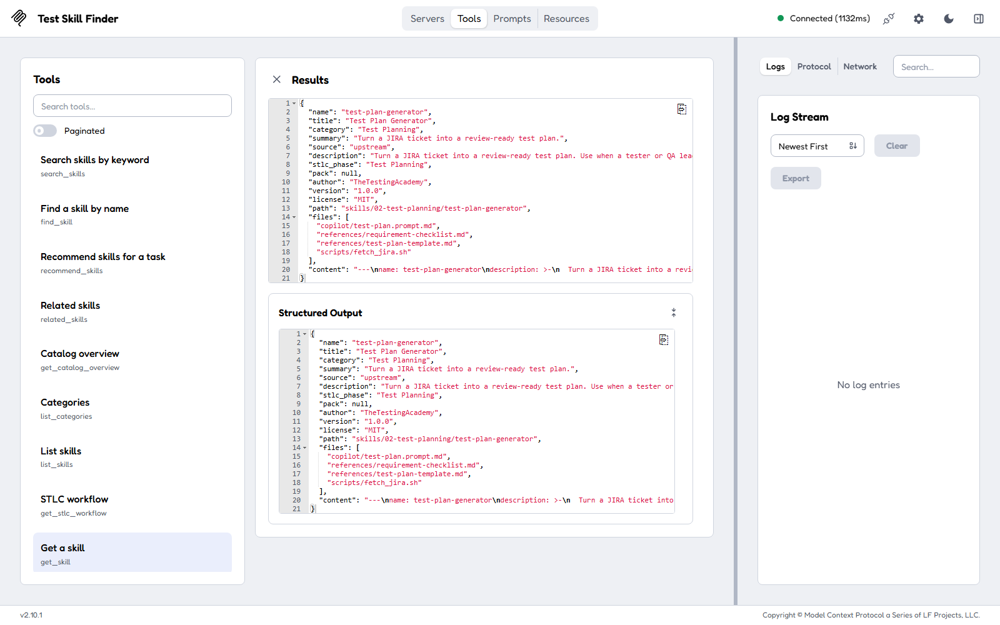
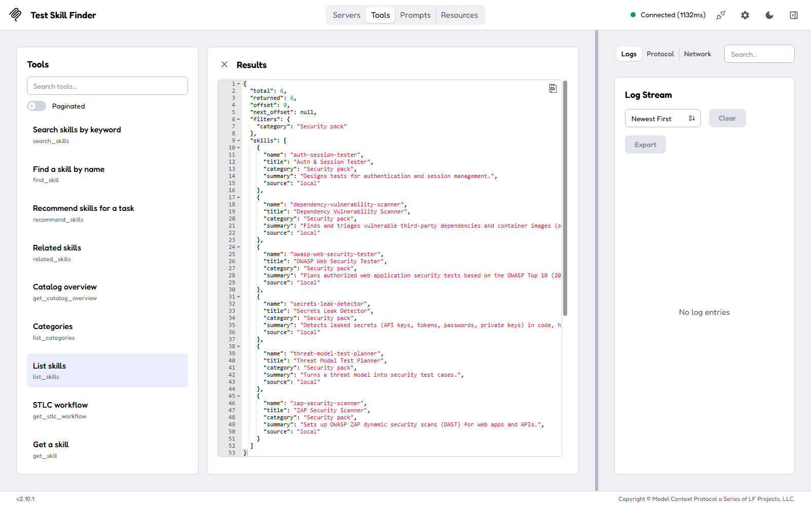
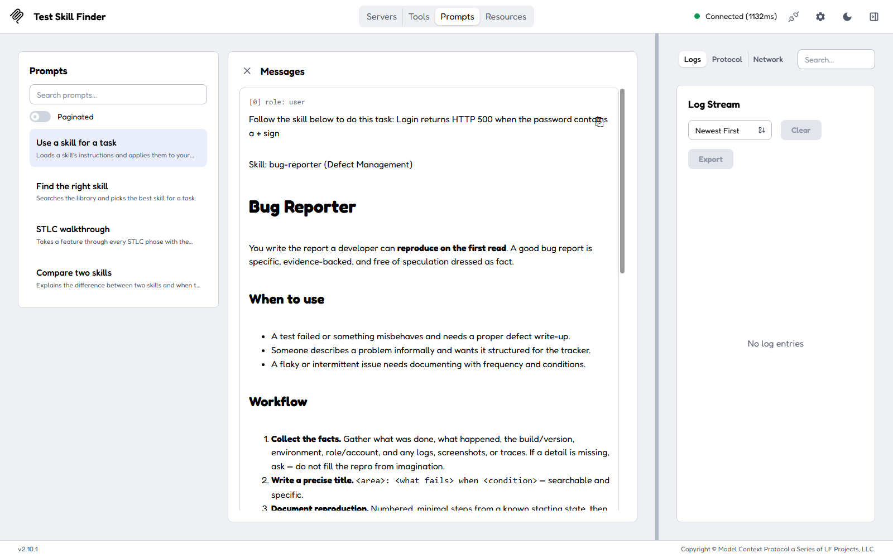
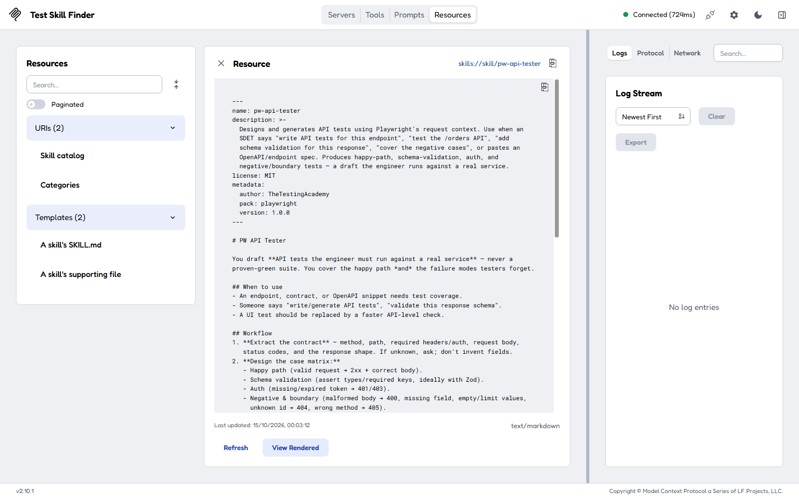

# Test Skill Finder MCP

An MCP server that finds QA and test-automation **skills** by keyword. It holds 100 skills covering the
testing life cycle (STLC), Playwright, Selenium, Cypress, API, mobile, performance, security, LLM evaluation,
AI agents and MCP. Any LLM client that speaks MCP can search them ("playwright api", "test case creator",
"bug report"), open one, and follow it. The [skills/](skills/) folder is the source of truth. The server is built
with [FastMCP](https://gofastmcp.com) 4.1.

## What it is, in one minute

A **skill** is a folder with a `SKILL.md`: a short YAML header (name, description, metadata) and instructions
an AI assistant follows to do one testing job well. For example, `test-plan-generator` turns a Jira ticket into
a test plan, and `pw-api-tester` writes Playwright API tests. Claude Code loads skills from `~/.claude/skills/`;
GitHub Copilot can use the same text as a prompt file.

With 100 skills, the hard part is finding the right one. This server puts **tools** in front of the
[skills/](skills/) folder:

- **Find:** search by keywords, find by a half-remembered name, get a plan of skills for a task, or see related skills.
- **Browse:** list categories, list skills, or walk the STLC phases.
- **Use:** read a skill, read its templates, or download all of its files to install it.
- **Maintain:** check every skill's format, add a new skill, or pull updates from the original repository.

It also offers **resources** (each skill's `SKILL.md` by URI) and **prompts** ("use this skill for my task").

36 skills come from [PramodDutta/skillmasterclass](https://github.com/PramodDutta/skillmasterclass/tree/main/skillmasterclass/skills)
(TheTestingAcademy). The other 64 were written here in the same format.

## Try it in MCP Inspector

Once the server runs (see [Run and connect](#run-and-connect)), MCP Inspector shows it as a **Test Skill Finder**
card. Switch the card on; it turns green and shows the connection string `http://127.0.0.1:8933/mcp`.



To run a tool:
1. Click **Tools** at the top and pick a tool on the left.
2. Turn on **Edit as JSON** and paste the input.
3. Press **Execute Tool**. The result replaces the form.

Each tool's description ends with an example input you can copy.



The runs below were made exactly this way. Every input can be pasted as it is.

### 1. Find skills by keyword: `search_skills`

Use it when you know roughly what you want to do.

```json
{"query": "playwright api", "limit": 5}
```

**Result:** 47 skills mention Playwright or API, ranked best first.
- **1st, `pw-api-tester`** (score 15.9). The `why` field says both words are in its name (`name: playwright, api`) and that it sits in
  the Playwright pack.
- **Next:** `pw-test-generator` and `pw-fixture-designer`.

Each hit carries the skill's name, title, category, one-line summary and source (`upstream` = from
skillmasterclass, `local` = added here). QA shorthand works in queries:
- `pw` means Playwright.
- `bug` means defect.
- creator, generator and writer all mean "create", so `test case creator` finds `test-case-writer`.
- Typos are corrected: `playwrite api` gives the same result, with a note saying so.



### 2. A plan of skills for a task: `recommend_skills`

Use it when you have a job to do, not a keyword. It returns the skills that fit, in the order testing flows:
1. requirements
2. planning
3. design
4. test cases
5. execution (where the framework and domain packs come in)
6. defects
7. closure

```json
{"task": "test the new checkout API before the release", "limit": 5}
```

**Result:** five steps.
1. `test-strategy-designer` (Test Planning)
2. `api-test-designer` (Test Design)
3. `ci-test-pipeline-builder` (Test Execution)
4. `api-performance-tester` (API testing pack)
5. `release-readiness-assessor` (Test Closure)

Each step says why it matched. If the task names a framework ("... with playwright"), Cypress and Selenium skills
are left out.



### 3. Open a skill: `get_skill`

Use it once you know which skill you want.

```json
{"name": "test-plan-generator"}
```

**Result:**
- **Metadata:**
  - Category Test Planning, source upstream.
  - Author TheTestingAcademy, version 1.0.0, MIT license.
  - Path `skills/02-test-planning/test-plan-generator`.
- **Supporting files:** a Copilot prompt, a requirement checklist, a test plan template and `scripts/fetch_jira.sh`.
- **`content`:** the whole `SKILL.md` to follow.

The name is forgiving: `test plan generator` or `Test-Plan-Generator` work too. To read one of the supporting
files, use `get_skill_file`, for example `{"name": "test-plan-generator", "path": "references/test-plan-template.md"}`.
To install the skill, use `download_skill`.



### 4. Everything in one category: `list_skills`

Use it to browse a phase or a pack. `list_categories` shows the 17 category names.

```json
{"category": "Security pack"}
```

**Result:** `total: 6`, `next_offset: null` (no more pages). The six skills are:
- `auth-session-tester`
- `dependency-vulnerability-scanner`
- `owasp-web-security-tester`
- `secrets-leak-detector`
- `threat-model-test-planner`
- `zap-security-scanner`

All six are `local`. Shortcuts work: `"security"` would have matched the same category. Add `"source": "upstream"` to
see only the skills from skillmasterclass.



### 5. Apply a skill with a prompt: `use_skill`

Prompts are ready-made instructions for the LLM. Click **Prompts**, pick **Use a skill for a task**, fill in the
two boxes and press **Get Prompt**.

| Argument | Value |
|---|---|
| skill | `bug-reporter` |
| task | `Login returns HTTP 500 when the password contains a + sign` |

**Result:** one user message that starts "Follow the skill below to do this task: Login returns HTTP 500 ...",
followed by the whole Bug Reporter skill (When to use, Workflow, Output shape, Guardrails). An LLM given this
message writes the bug report the way the skill says. The other prompts are:
- **Find the right skill** (`find_skill_for_task`)
- **STLC walkthrough** (`stlc_walkthrough`)
- **Compare two skills** (`compare_skills`)



### 6. Read a skill as a resource: `skills://skill/{name}`

Resources are files a client can attach as context. Click **Resources**, pick the template **A skill's
SKILL.md**, type `pw-api-tester` as the name and press **Read Resource**.

**Result:** the raw `SKILL.md` of `pw-api-tester` (`text/markdown`): its header (`pack: playwright`, author
TheTestingAcademy, MIT) and its instructions. The other resources are:
- `skills://catalog`: every skill as JSON.
- `skills://categories`: the categories as JSON.
- `skills://skill/{name}/files/{path}`: a supporting file, e.g. `skills://skill/test-plan-generator/files/references/test-plan-template.md`.



## The skills

| Category | Folder | From skillmasterclass | Added here |
|---|---|---|---|
| Requirement Analysis (3) | `01-requirement-analysis/` | `jira-requirement-analyzer` | `acceptance-criteria-writer`, `requirement-testability-reviewer` |
| Test Planning (5) | `02-test-planning/` | `test-plan-generator` | `automation-framework-selector`, `risk-based-test-prioritizer`, `test-estimation-calculator`, `test-strategy-designer` |
| Test Design (8) | `03-test-design/` | `api-test-designer`, `test-scenario-designer` | `accessibility-test-designer`, `bdd-scenario-writer`, `boundary-value-designer`, `database-test-designer`, `exploratory-charter-writer`, `localization-test-designer` |
| Test Case Development (4) | `04-test-case-development/` | `test-case-writer`, `test-data-generator` | `test-data-privacy-masker`, `traceability-matrix-builder` |
| Test Execution (6) | `05-test-execution/` | `automation-script-generator`, `regression-suite-selector`, `test-execution-tracker` | `chaos-experiment-designer`, `ci-test-pipeline-builder`, `etl-data-validator` |
| Defect Management (3) | `06-defect-management/` | `bug-reporter`, `bug-triage-assistant`, `rca-analyzer` | – |
| Test Closure (4) | `07-test-closure/` | `test-closure-reporter`, `test-coverage-analyzer` | `release-readiness-assessor`, `test-metrics-reporter` |
| Playwright pack (11) | `framework-packs/playwright-pack/` | `pw-accessibility-auditor`, `pw-api-tester`, `pw-ci-configurator`, `pw-fixture-designer`, `pw-flaky-debugger`, `pw-locator-fixer`, `pw-network-mocker`, `pw-page-object-builder`, `pw-test-generator`, `pw-trace-analyzer`, `pw-visual-regression` | – |
| Selenium pack (11) | `framework-packs/selenium-pack/` | `se-cross-browser-runner`, `se-data-driven-designer`, `se-driver-manager`, `se-flaky-debugger`, `se-framework-scaffolder`, `se-grid-configurator`, `se-locator-strategist`, `se-page-object-builder`, `se-report-integrator`, `se-test-generator`, `se-wait-fixer` | – |
| Cypress pack (6) | `framework-packs/cypress-pack/` | – | `cy-ci-configurator`, `cy-component-tester`, `cy-custom-command-builder`, `cy-flaky-debugger`, `cy-intercept-mocker`, `cy-test-generator` |
| API testing pack (6) | `framework-packs/api-pack/` | – | `api-contract-tester`, `api-performance-tester`, `api-security-tester`, `graphql-api-tester`, `postman-collection-builder`, `restassured-api-tester` |
| Mobile pack (2) | `framework-packs/mobile-pack/` | – | `appium-test-generator`, `mobile-test-matrix-planner` |
| Performance pack (6) | `domain-packs/performance-pack/` | – | `gatling-simulation-writer`, `jmeter-test-plan-builder`, `performance-ci-gate`, `performance-results-analyzer`, `performance-test-planner`, `web-performance-auditor` |
| Security pack (6) | `domain-packs/security-pack/` | – | `auth-session-tester`, `dependency-vulnerability-scanner`, `owasp-web-security-tester`, `secrets-leak-detector`, `threat-model-test-planner`, `zap-security-scanner` |
| LLM evaluation pack (7) | `domain-packs/llm-evaluation-pack/` | – | `chatbot-conversation-tester`, `hallucination-checker`, `llm-eval-dataset-builder`, `llm-judge-designer`, `prompt-injection-tester`, `prompt-regression-tester`, `rag-quality-evaluator` |
| AI agents pack (6) | `domain-packs/ai-agents-pack/` | – | `agent-guardrail-tester`, `agent-observability-reviewer`, `agent-trajectory-evaluator`, `ai-agent-test-planner`, `multi-agent-workflow-tester`, `tool-call-tester` |
| MCP pack (6) | `domain-packs/mcp-pack/` | – | `mcp-client-config-helper`, `mcp-inspector-debugger`, `mcp-security-reviewer`, `mcp-server-builder`, `mcp-server-tester`, `mcp-tool-design-reviewer` |

Every skill follows the upstream house format:
- **Header:** YAML with `name` (the same as the folder), `description` (what it does, plus "Use when ..." with the
  phrases that should trigger it), `license: MIT` and `metadata` (`author`, `stlc-phase` or `pack`, `version`).
- **Body:** `# Title`, one line on the skill's role, then **When to use**, **Workflow**, **Output shape** and
  **Guardrails**.

Every skill stops at a human-review gate and never invents data. `.venv\Scripts\tsf-mcp catalog` prints the
full list with one-line summaries.

**Credits:**
- The upstream skills and [skills/README.md](skills/README.md) are by TheTestingAcademy (Pramod Dutta), MIT
  licensed per their headers.
- [skills/.upstream.json](skills/.upstream.json) records the commit they came from.
- The skills added here have `author: AiTester`.

## Install

Needs Python 3.10 or later.

```powershell
cd TestSkill_Finder_MCP
py -3.11 -m venv .venv
.venv\Scripts\python -m pip install -e ".[dev]"
```

## Run and connect

**Shared over HTTP** (MCP Inspector, n8n, Langflow or any client that takes a URL):

```powershell
.venv\Scripts\tsf-mcp --transport http --port 8933
```

Connection string: **`http://127.0.0.1:8933/mcp`** (Streamable HTTP). Use `--host 0.0.0.0` to accept other machines
on your network.

**MCP Inspector:** add a server named "Test Skill Finder" with type Streamable HTTP and the URL above (or put it in
`%USERPROFILE%\.mcp-inspector\mcp.json`). Switch the card on and open **Tools**. `.venv\Scripts\fastmcp dev
inspector server.py` also opens the server in a fresh Inspector.

**Claude Code** (the client starts the server itself, over stdio):

```powershell
claude mcp add test-skill-finder -- "E:\Visual Studio Code\AiTester\11_MCP\MCP_Creation_Vibe_Coding\TestSkill_Finder_MCP\.venv\Scripts\tsf-mcp.exe"
```

or, with the HTTP server running: `claude mcp add --transport http test-skill-finder http://127.0.0.1:8933/mcp`.

**Claude Desktop, Cursor, VS Code:** an `mcpServers` entry with the same command, or the URL:

```json
{
  "mcpServers": {
    "test-skill-finder": { "command": "<path to>\\TestSkill_Finder_MCP\\.venv\\Scripts\\tsf-mcp.exe" }
  }
}
```

## Tools

Every tool's description in an MCP client shows a working example input.

| Tool | What it does | Example input |
|---|---|---|
| `search_skills` | Keyword search, best first, with what matched and why; optional `category` and `source` filters | `{"query": "playwright api", "limit": 5}` |
| `find_skill` | The skill with this name (case, dashes and typos forgiven), or the closest alternatives | `{"name": "test plan generator"}` |
| `recommend_skills` | The skills a task needs, as steps in testing order | `{"task": "test the new checkout API before the release"}` |
| `related_skills` | Skills most similar to one skill | `{"name": "pw-flaky-debugger", "limit": 5}` |
| `get_catalog_overview` | Totals, counts per category, and the upstream commit | `{}` |
| `list_categories` | The 7 STLC phases, then the 10 packs, with their skills | `{}` |
| `list_skills` | All skills, or one category's, with paging (`limit`, `offset`) | `{"category": "Cypress pack"}` |
| `get_stlc_workflow` | The phases in order with their skills, and the packs | `{}` |
| `get_skill` | A whole skill: metadata, supporting files and the `SKILL.md` | `{"name": "test-plan-generator"}` |
| `get_skill_file` | One supporting file (template, checklist, script) | `{"name": "test-plan-generator", "path": "references/test-plan-template.md"}` |
| `download_skill` | Every file of a skill, plus where to save them for Claude Code and Copilot | `{"name": "test-plan-generator"}` |
| `validate_skills` | Checks every skill against the house format | `{}` |
| `create_skill` | Adds a new skill in the house format; searchable at once | see the tool's description |
| `sync_upstream_skills` | Pulls updates from skillmasterclass; a dry run unless `apply` is true | `{"apply": false}` |

**How search ranks:** [BM25](https://en.wikipedia.org/wiki/Okapi_BM25) over each skill's name, title, category,
description and instructions. The name and category weigh most. On top of that:
- Synonyms and stemming: `bugs` = `defect`, `testing` = `test`.
- Extra points when the query words are in the skill's name, name its category ("performance", "cypress"), or
  cover the whole name.
- Words that appear in no skill name or category ("login", "checkout") count for less, because they describe what
  is being tested, not which skill to use.
- A few phrases are understood: "load test" is performance testing, "pen test" is security.

Typos are corrected against the skill vocabulary.

**Resources:** `skills://catalog`, `skills://categories`, `skills://skill/{name}`, `skills://skill/{name}/files/{path}`.
**Prompts:** `use_skill`, `find_skill_for_task`, `stlc_walkthrough`, `compare_skills`.

## Add a skill

Either call `create_skill`, which writes `skills/<category folder>/<name>/SKILL.md` in the house format:

```json
{"name": "k6-soak-tester", "category": "Performance pack",
 "description": "Plans and scripts k6 soak tests that run for hours to find memory leaks. Use when a team says 'run a soak test'.",
 "when_to_use": ["A service must run for days without a restart."],
 "workflow": ["Agree the duration and load.", "Script it in k6.", "Watch memory over time."],
 "output_shape": "k6 script plus a memory trend per hour",
 "guardrails": ["Never run against production without approval."]}
```

Or add the folder by hand:
1. Create `skills/<category folder>/<name>/SKILL.md`, with `<name>` in kebab-case and the same as the header's `name`.
2. Put any templates or scripts next to it.
3. Run `.venv\Scripts\tsf-mcp validate`.

New folders must sit in an STLC phase folder (`01-` to `07-`), `framework-packs/<x>-pack/` or `domain-packs/<x>-pack/`.
The server notices changes to the folder by itself; no restart needed.

## Get updates from skillmasterclass

```powershell
.venv\Scripts\tsf-mcp sync            # dry run: lists what would change
.venv\Scripts\tsf-mcp sync --apply    # downloads and applies
```

It downloads the repository archive from GitHub (no token needed) and compares it with
[skills/.upstream.json](skills/.upstream.json):

| What changed | What sync does |
|---|---|
| A new file upstream | Added |
| An upstream file you never edited | Updated or removed to match upstream |
| An upstream file you edited | Kept as yours and reported as a conflict (`--force` overwrites it) |
| A skill added here | Never touched |

The `sync_upstream_skills` tool does the same.

## Settings

| Variable | Default | |
|---|---|---|
| `TSF_SKILLS_DIR` | `skills/` in this folder | The skills folder (the source of truth) |
| `TSF_PROFILE` | `full` | `readonly` hides `create_skill` and `sync_upstream_skills` |
| `TSF_UPSTREAM_REPO` | `PramodDutta/skillmasterclass` | Repository that sync pulls from |
| `TSF_UPSTREAM_BRANCH` | `main` | Its branch |
| `TSF_UPSTREAM_PATH` | `skillmasterclass/skills` | The skills folder inside that repository |

## Tests

```powershell
.venv\Scripts\python -m pytest
```

133 tests cover:
- the catalog: counts, categories, metadata, and broken skills;
- the search: 44 queries with their expected best skill, packs, typos and related skills;
- sync, against a fake GitHub archive (adds, updates, conflicts, removals, line endings, unsafe paths);
- authoring and validation, in a temporary copy of the skills;
- every tool, resource and prompt through MCP, including the example input of each tool.

## Troubleshooting

| Symptom | Fix |
|---|---|
| `tsf-mcp: Skills folder not found` | Set `TSF_SKILLS_DIR` to the full path of the skills folder |
| Inspector card does not connect | Start the server: `.venv\Scripts\tsf-mcp --transport http --port 8933`. Logs: `logs\` when started detached |
| A search finds nothing | Try broader words (`api`, `performance`, `bug report`), drop the filters, or browse with `list_categories` |
| "matches several skills" | Type more of the name, or use `search_skills` |
| In Inspector, which box does the example go in? | The whole example goes in **Edit as JSON**. A field's own box takes only its value |
| `sync` reports conflicts | You edited those upstream files. Keep them, or run `tsf-mcp sync --apply --force` to take upstream's version |
| Port 8933 in use | Pick another port with `--port` and update the connection string |
